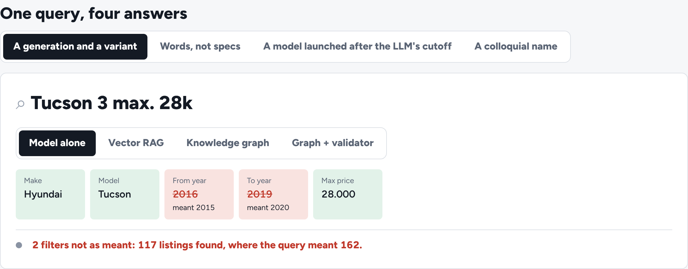

# vehicle-knowledge-search

Natural-language car search has to turn *"Golf 7 GTI unter 20 Tsd"*, *"sparsamer Familien-SUV mit
Anhängerkupplung"* or *"Skoda Elroq bis 40.000 €"* into the filters of a result page. An LLM on its own gets about
six in ten of those right. It remembers generation years and engine powers slightly wrong, has never heard of a car
launched after its training cutoff, and has its own idea of what "sparsam" means. This repository grounds the search
in a vehicle knowledge graph and compares four ways of doing it on the same ground truth. It also builds that ground
truth, and monitors the system through twelve production weeks in which the world changes under it.

- **A knowledge graph** of make → model → generation → variant (years, fuel, power, gearbox, drive, seats,
  consumption), colloquial names ("Dreier", "Cinquecento"), and the concepts people search with. Each concept carries
  the filters the catalogue means by it.
- **Four systems around one simulated LLM:** the model alone; vector RAG over documents written from the graph;
  graph retrieval (entity linking and traversal); and the graph with a validator that checks every filter against
  the catalogue, repairs what it can, flags names it cannot link, and suggests a relaxed search when nothing matches.
- **Ground truth:** labelled queries scored by exact filters and by result sets. Sessions show how far clicks and
  contacts go as labels, and how far they don't.
- **Monitoring without labels:** zero-result rate, unknown names, invalid values and query drift (PSI) on twelve
  weeks with a season change, a model launch the graph learns about two weeks late, and an LLM upgrade with a
  regression. Each week also has a small labelled sample.
- **A gate** for every change to retrieval, prompts, the model or the agent. It checks the development queries and
  the production queries the monitors flagged, which a person labels.
- **An agent-ready repository**: `AGENTS.md` with the invariants and how to check them, isolation and invariant tests,
  a CI gate, configuration in one file, generated reports. A coding agent can change it safely.



## Results

<!-- results:start -->
Held-out run: 160 queries × 3 repeats, run once at commit `097afbc`.

| | Exact filters | Result sets (Jaccard) | Zero results | p95 latency | Cost per query |
|---|---|---|---|---|---|
| Model alone | 59.8% (53%–66%) | 0.761 | 11.9% | 1.83 s | €0.0027 |
| Vector RAG | 96.2% (94%–98%) | 0.986 | 10.2% | 1.90 s | €0.0049 |
| Knowledge graph | 96.9% (95%–98%) | 0.986 | 10.2% | 1.90 s | €0.0031 |
| Graph + validator | 96.9% (95%–98%) | 0.986 | 10.2% | 2.03 s | €0.0031 |

Budgets: p95 2.5 s, €0.004 per query.

By kind of query (held out, exact filters):

| Kind | Model alone | Vector RAG | Knowledge graph | Graph + validator |
|---|---|---|---|---|
| alias | 78% | 94% | 94% | 94% |
| concept | 21% | 93% | 96% | 96% |
| explicit | 82% | 98% | 98% | 98% |
| generation | 69% | 97% | 97% | 97% |
| new model | 27% | 98% | 98% | 98% |

Twelve production weeks (exact filters per week; alerts from the label-free monitors):

| Week | What happened | Graph, no validator | Graph + validator | Alerts (graph + validator) |
|---|---|---|---|---|
| 1 |  | 94.8% | 94.8% | – |
| 2 |  | 97.2% | 97.2% | – |
| 3 |  | 97.0% | 97.0% | – |
| 4 |  | 96.8% | 96.8% | – |
| 5 |  | 96.5% | 96.5% | – |
| 6 | winter: all-wheel drive and SUVs | 95.8% | 95.8% | query drift |
| 7 | Kia EV2 goes on sale | 92.9% | 92.9% | unknown entities, hallucinations, query drift |
| 8 |  | 93.6% | 93.6% | unknown entities, hallucinations, query drift |
| 9 | EV2 reaches the knowledge graph | 96.9% | 96.9% | – |
| 10 | the LLM is upgraded | 86.3% | 95.3% | hallucinations, query drift |
| 11 |  | 86.1% | 95.5% | hallucinations, query drift |
| 12 |  | 86.8% | 96.0% | hallucinations, query drift |

Ground truth from behaviour: contacts are right 99.4% of the time but cover 3.6% of the relevant listings, and 126 of 320 queries get any. Judged by contacts, the model alone scores 82.1%; its exact-filter rate is 62.7%.

Production cases: 167 queries the linker or validator flagged, labelled; the graph + validator passes 138, the graph without it 21.

Gate (development queries and production cases):

| Change | Decision | Why |
|---|---|---|
| answer from the model's own knowledge (no retrieval) | blocked | exact answers may drop: -34.0 pts, lower bound -38.8; fails 104 production case(s) the current system passes |
| switch the graph for vector retrieval | blocked | fails 117 production case(s) the current system passes; €0.0048 per query, over the €0.004 budget |
| drop the validator to save a tool call | blocked | fails 117 production case(s) the current system passes |
| same system, run again (A/A) | passes | exact +0.6 pts (lower bound -0.6) |
<!-- results:end -->

## What each system gets wrong, and why

| Query | The model alone | Vector RAG | Graph | Graph + validator |
|---|---|---|---|---|
| A generation and a variant ("BMW 3er F30 330i") | years and power from memory, wrong for a quarter of generations | right when the generation's document is retrieved | right: years and power from the catalogue | same as the graph |
| Words, not specs ("sparsam", "familientauglich") | its own thresholds: 6.6 l instead of 5.5, seven seats instead of five | right when the concept document is in the top four | right: the concept node carries the filters | same |
| A model after its cutoff ("Skoda Elroq") | substitutes a Skoda it knows, 60% of the time | right: the model's document exists | right | right |
| A model the graph doesn't know yet (EV2, weeks 7–8) | substitutes | substitutes | substitutes | keeps the user's word, never a substitute, and logs the name for the graph team |
| The upgraded LLM reads "unter 38 Tsd" as 38 € (weeks 10–12) | zero results | zero results | zero results | the validator sees a price below 500 € and repairs it |

## What the numbers do and do not show

- **The catalogue and the model are simulated.** Make and model names are real; generations, years, powers and
  prices are synthetic and only plausible. The model's mistakes come from its own copy of the catalogue: older,
  partly wrong, without three newer models. Its reading of queries uses configured error rates.
- **Vector RAG and the graph are close here.** On this 32-model catalogue the TF-IDF retriever rarely misses, so
  graph retrieval is only 0.6 points better (the interval runs from 0 to about 2). It is 37% cheaper, because it
  passes facts instead of documents. With a full catalogue the retriever would compete with far more similar
  documents; that is not measured here.
- **The validator adds nothing on the development queries** and is still worth its tool call. In production it
  turned the LLM upgrade's misreading into an alert instead of a 9-point drop. During the launch it kept wrong models
  out of the results. The gate catches its removal only through the labelled production cases.
- **Forty labels a week are not enough to see a ten-point drop.** The weekly sample's interval spans about 20
  points. The zero-result monitor saw the regression without any labels.
- **Contacts are precise but sparse.** They exist for 4% of the listings that fit a query. They cannot tell the
  three grounded systems apart, and they rate the model alone 19 points above its real score. Use them to find
  queries to label, not to score.
- **One labelling rule was fixed during development.** The generator gave queries like "Kia EV6" (a generation named
  exactly like its model) the generation's years. `evals/truth.py` drops those years for every split. This was found
  on development queries, before the held-out run.

## Run it

```bash
pip install -e ".[dev]"
make test                            # 20 tests
make eval                            # development evaluation -> reports/dev.json, about 4 minutes
python scripts/gate.py               # A/A rerun of the graph + validator: passes
python scripts/gate.py graph         # dropping the validator: blocked by the production cases
make report                          # results.json, RESULTS.md, this README's block, the dashboard's data
cd web && npm ci && npm run dev      # the dashboard
```

## Layout

| Path | What |
|---|---|
| `scripts/build_world.py` | The knowledge graph, the model's own knowledge, listings, queries, production weeks, and what each query means |
| `src/vks/search/catalog.py` | Listings and filters, the graph with entity linking, the vector index, the validator |
| `src/vks/agents/systems.py` | The four systems around the simulated model |
| `src/vks/evals/` | Scoring, the labelling rule, sessions, production and monitors, mining, statistics, the gate |
| `evalcases/production.jsonl` | Production queries the linker or validator flagged, for labelling |
| `logs/production.jsonl` | What production saw and did; no verdicts |
| `web/` | The dashboard: React, TypeScript and Framer Motion |
